<div align="center">

# 🐚 Nácar

**Una shell de escritorio líquida, viva y tornasolada para KDE Plasma 6.**
*Creada por [ItsNurex](https://github.com/ItsNurex) con [Quickshell](https://quickshell.org). El nácar es la parte que brilla por dentro de la concha.*

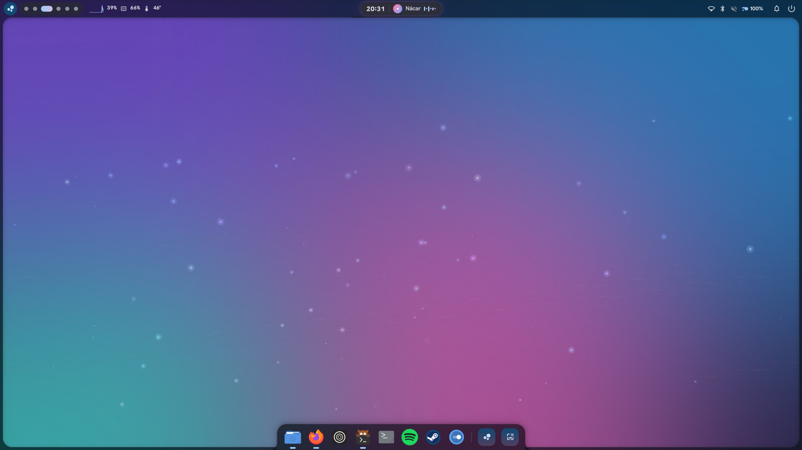

</div>

---

## ✨ Qué la hace distinta

| | |
|---|---|
| 🌊 **Marco líquido** | La barra y el borde de la pantalla son **una sola pieza**. Los paneles *brotan* del marco con un muelle y se funden con él con esquinas cóncavas. |
| 🏝️ **Isla dinámica** | El reloj del centro **cambia de forma**: se estira con la música, con cada aviso, con el volumen, al cambiar de escritorio… y se transforma en el calendario. |
| 🎨 **Toda la shell toma el color de tu fondo** | Elige un fondo en el **carrusel 3D** y barra, isla, paneles y dock se funden hacia su paleta (Material 3 vía matugen). |
| 🎵 **La música la ilumina** | Los colores de la carátula tiñen la isla, el halo late con el bajo y una onda recorre la barra de progreso. |
| 🫧 **Cristal de verdad** | Desenfoque nativo de KWin en marco, paneles y dock, con sombras que dan profundidad. |
| 🚀 **Dock líquido** | Ampliación en ola al pasar el ratón, rebote al abrir y punto en las apps abiertas. Si la app ya está abierta, la trae al frente. |
| 🔮 **Omni** | Una sola caja para todo: apps (con frecencia), ventanas abiertas, calculadora con unidades, comandos, web, emojis, portapapeles, archivos y acciones. |
| 🌙 **Detalles con cariño** | Entrada animada al arrancar, despedida escrita letra a letra al apagar, polvo de nácar flotando, botones de gelatina y brillo tornasol cuando algo pasa. |

## 📸 Capturas

<table>
<tr>
<td>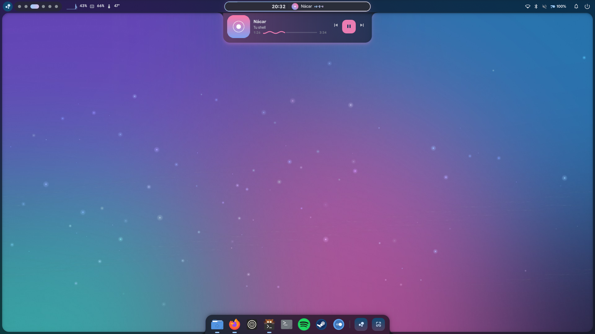<br><sub><b>Isla dinámica</b> · reproductor teñido con la carátula</sub></td>
<td>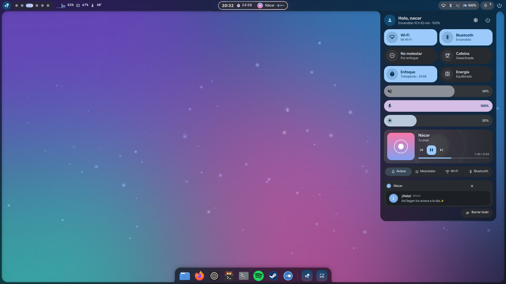<br><sub><b>Centro de control</b> · brota del marco</sub></td>
</tr>
<tr>
<td>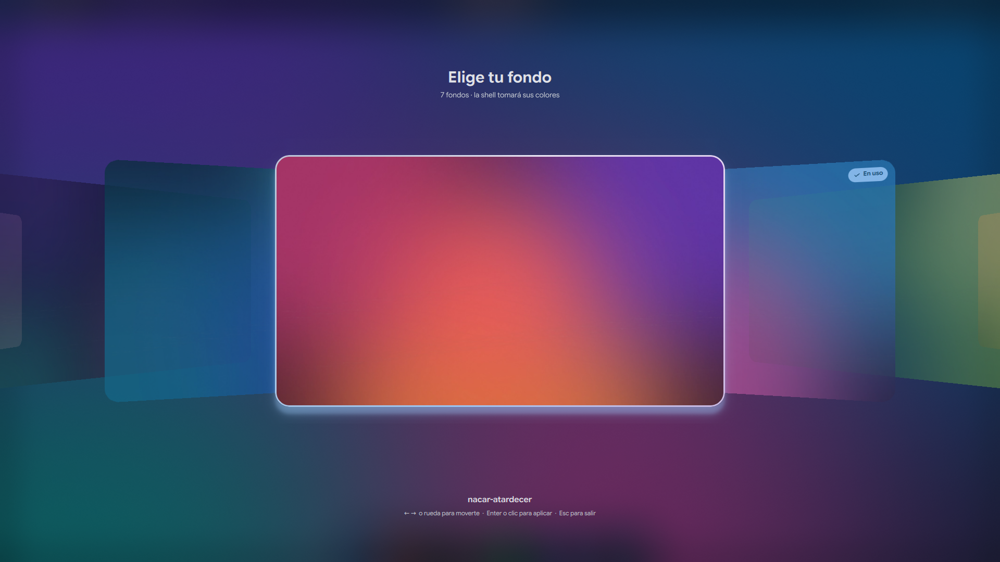<br><sub><b>Carrusel 3D de fondos</b></sub></td>
<td>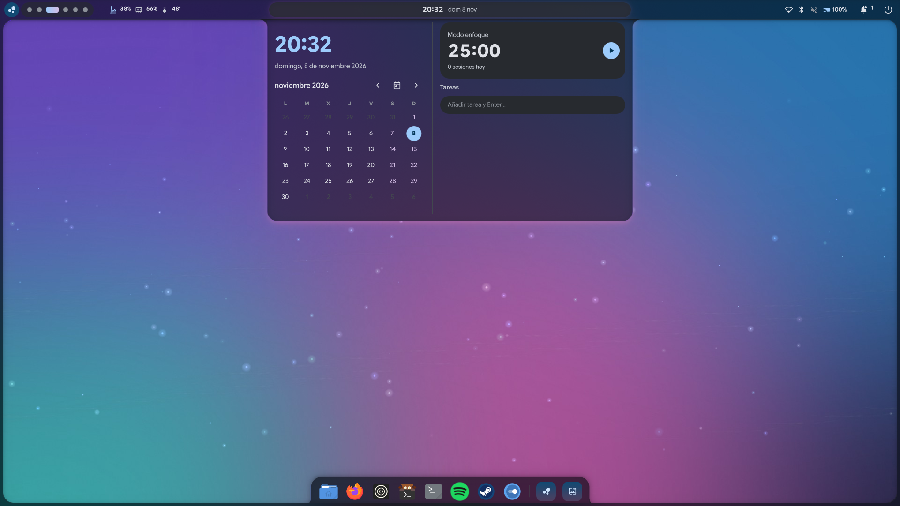<br><sub><b>La isla se convierte en calendario</b> · pomodoro y tareas</sub></td>
</tr>
<tr>
<td>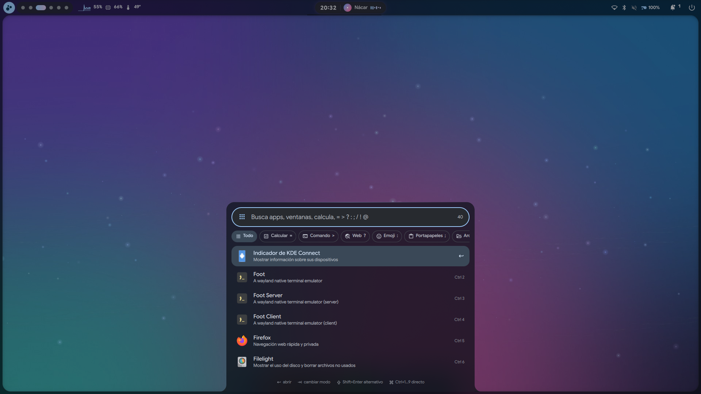<br><sub><b>Omni</b> · el lanzador que lo hace todo</sub></td>
<td>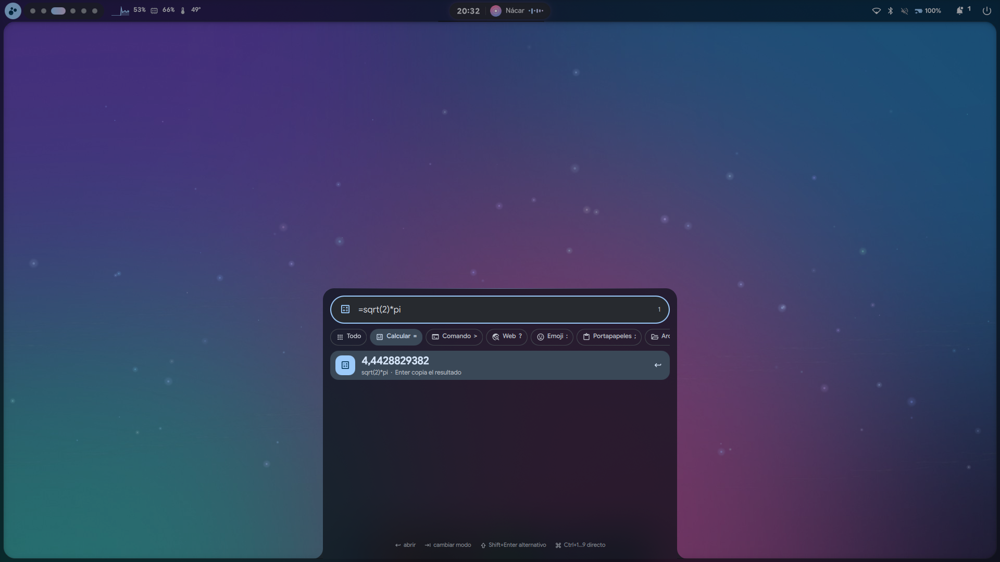<br><sub><b>Calculadora</b> · <code>=5 km a mi</code>, <code>=15% de 80</code></sub></td>
</tr>
<tr>
<td>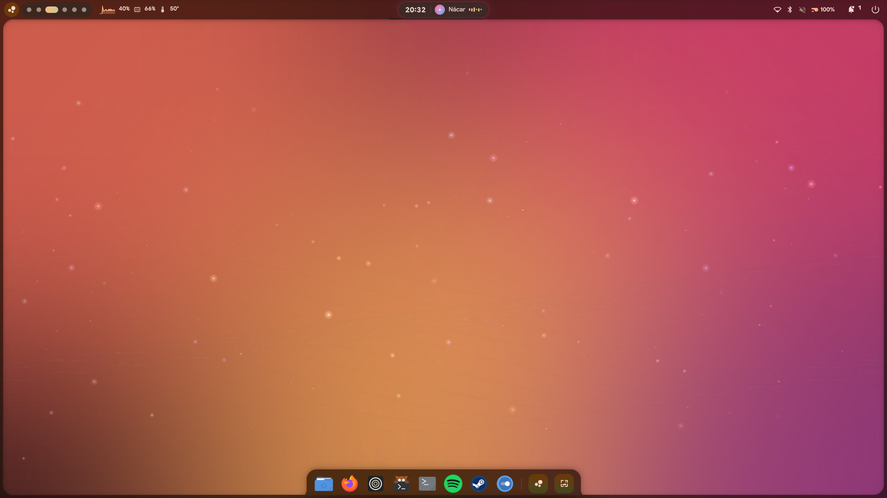<br><sub>Fondo <b>coral</b> → shell cálida</sub></td>
<td>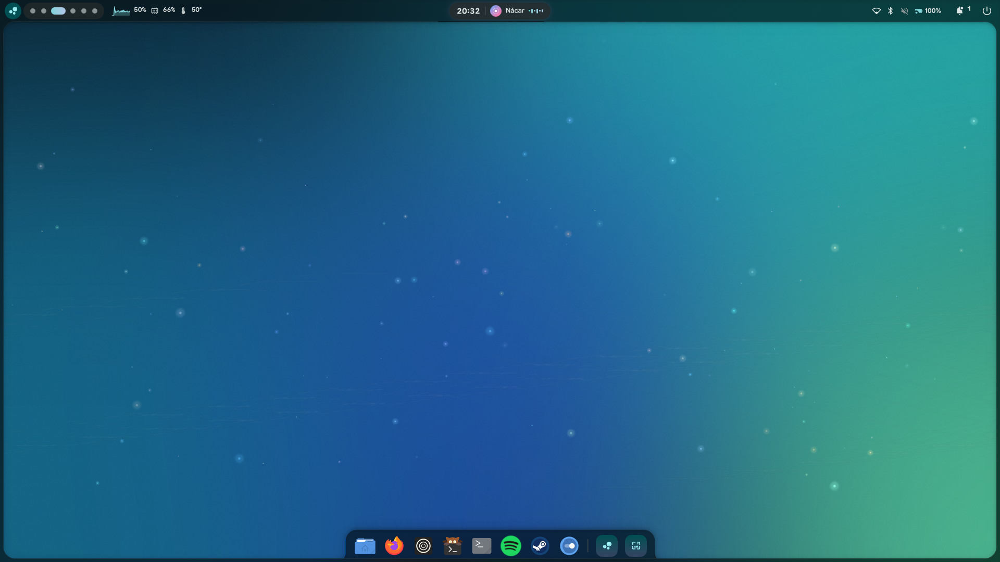<br><sub>Fondo <b>océano</b> → shell turquesa</sub></td>
</tr>
<tr>
<td>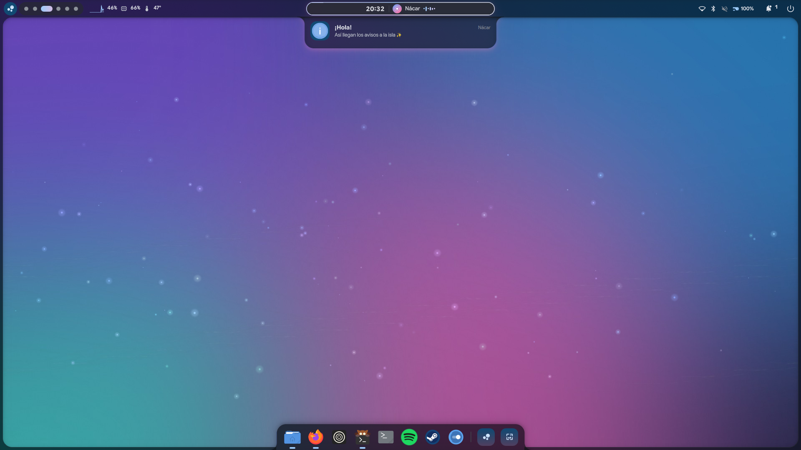<br><sub>Los avisos llegan a la isla con brillo tornasol</sub></td>
<td>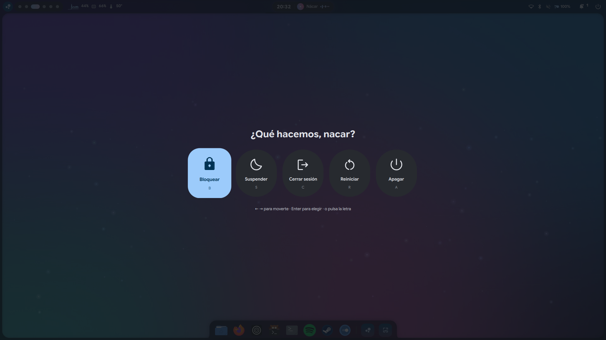<br><sub>Menú de sesión con cuenta atrás cancelable</sub></td>
</tr>
</table>

## 🧩 Todo lo que trae

- **Barra**: escritorios virtuales con indicador "gusano" líquido, CPU con mini-gráfica, RAM, temperatura, bandeja plegable, red, Bluetooth, volumen, batería y campana de avisos.
- **Isla dinámica**: reloj · música · avisos · volumen/micro/brillo · escritorio actual · calendario.
- **Centro de control**: Wi-Fi, Bluetooth, No molestar, Cafeína (pantalla despierta), modo Enfoque y perfil de energía; deslizadores de volumen, micro y brillo; reproductor; pestañas de **avisos agrupados**, **mezclador por app**, **redes Wi-Fi** y **dispositivos Bluetooth**.
- **Avisos**: historial persistente (sobrevive a reinicios), agrupados por app, acciones, **respuesta rápida**, imágenes y progreso. Los simples van a la isla y los "ricos" salen como tarjeta.
- **Modo enfoque (pomodoro)**: silencia los avisos mientras trabajas y cuenta tus sesiones del día.
- **Omni**: `=` calcular · `>` comando · `?` web · `:` emoji · `;` portapapeles · `/` archivos · `!` acciones · `@` ventanas. `Tab` cambia de modo y `Ctrl+1…9` abre directo.
- **Fondos**: carrusel 3D con 7 fondos propios de Nácar (+ los de tus carpetas).
- **Sesión**: bloquear, suspender, cerrar sesión, reiniciar y apagar, con teclado y despedida animada.
- **Todo configurable en caliente** en `~/.config/nacar/config.json`.

## 📦 Requisitos

- **KDE Plasma 6** sobre Wayland
- [`quickshell`](https://quickshell.org) 0.3 o superior (Qt 6.7+)
- `matugen` (paleta de colores), `python3`
- Recomendados: `cava` (visualizador), `brightnessctl`, `networkmanager` (`nmcli`), `cliphist` + `wl-clipboard` (portapapeles), `fd` (búsqueda de archivos), `spectacle`
- Fuentes: **Google Sans Flex** (o cambia `fontFamily`) y **Material Symbols Rounded**

En Arch / CachyOS:

```bash
yay -S quickshell-git matugen cava brightnessctl cliphist wl-clipboard fd ttf-material-symbols-variable
```

## 🚀 Probar sin instalar

Prueba Nácar **sin perder tu shell actual**: el script pausa la shell de Quickshell que tengas y la restaura al salir (`Ctrl+C`).

```bash
git clone https://github.com/ItsNurex/nacar.git
cd nacar
./scripts/try.sh
```

## 🛠️ Instalar

```bash
./install.sh
qs -c nacar
```

El instalador enlaza la carpeta en `~/.config/quickshell/nacar`. **No** activa el arranque automático ni toca tu configuración actual; eso lo decides tú.

> 💡 Nácar sustituye la barra de Plasma. Si quieres usarlo a diario, quita o oculta el panel de Plasma (clic derecho en el panel → *Mostrar alternativas* / *Eliminar panel*).

## ⌨️ Atajos (IPC)

Todo se controla con `qs -c nacar ipc call nacar <función>`. Asígnalos en **Ajustes del sistema → Atajos → Añadir comando**:

| Atajo sugerido | Comando |
|---|---|
| `Meta` | `qs -c nacar ipc call nacar omni` |
| `Meta + A` | `qs -c nacar ipc call nacar center` |
| `Meta + W` | `qs -c nacar ipc call nacar wallpapers` |
| `Meta + C` | `qs -c nacar ipc call nacar calendar` |
| `Meta + Esc` | `qs -c nacar ipc call nacar session` |
| `Meta + V` | `qs -c nacar ipc call nacar omniWith ";"` |
| `Meta + .` | `qs -c nacar ipc call nacar omniWith ":"` |
| `Meta + F` | `qs -c nacar ipc call nacar focus` |

Otras funciones: `notifications`, `mixer`, `dnd`, `caffeine`, `volumeUp`, `volumeDown`, `mute`, `micMute`, `brightnessUp`, `brightnessDown`, `playPause`, `next`, `previous`, `theme`, `toggleDark`, `close`.

## ⚙️ Ajustes

Edita `~/.config/nacar/config.json`; los cambios se aplican **al instante**. Algunos:

```jsonc
{
  "themeSource": "wallpaper",    // wallpaper | accent | "#ff6699" | /ruta/imagen
  "scheme": "scheme-tonal-spot", // esquema de matugen
  "darkMode": true,
  "panelOpacity": 0.78,
  "blur": true, "glow": true, "particles": true, "artColors": true,
  "frameThickness": 7,           // 0 = sin marco
  "dock": true,
  "dockApps": ["org.kde.dolphin", "firefox", "kitty"],
  "dockMagnify": 0.55,
  "desktopMusic": false,         // disco de música en el centro del escritorio
  "desktopClock": false,         // reloj grande en el escritorio
  "animationSpeed": 1.0,         // 0 = sin animaciones
  "focusMinutes": 25, "breakMinutes": 5,
  "wallpaperDirs": ["~/Pictures/Wallpapers"]
}
```

## 🗂️ Estructura

```
shell.qml            punto de entrada + IPC
services/            lógica (tema, audio, red, avisos, música, búsqueda…)
modules/frame/       marco líquido, barra e isla dinámica
modules/dock/        dock
modules/center/      centro de control
modules/omni/        lanzador
modules/wallpapers/  carrusel de fondos
modules/desktop/     escritorio vivo (partículas, fondo propio opcional)
components/          piezas reutilizables (Tab líquida, brillo nácar…)
lib/                 calculadora, búsqueda difusa, emojis
scripts/             paleta, fondos, prueba y capturas
wallpapers/          fondos de Nácar
```

## 🙏 Inspiración

Nácar está escrita desde cero, pero se inspira en las ideas de shells increíbles de la comunidad:
[Caelestia](https://github.com/caelestia-dots/shell) (el marco que cambia de forma),
[Caparazón de Ezku](https://github.com/ezku100/caparazon-shell) (shell para KDE en español),
[43PR](https://github.com/43PR/dotfiles) (carrusel de fondos),
[Ambxst](https://github.com/Axenide/Ambxst) y
[DankMaterialShell](https://github.com/AvengeMedia/DankMaterialShell).
Gracias a [Quickshell](https://quickshell.org) por hacerlo posible.

## 📄 Licencia

[MIT](LICENSE) © ItsNurex. Los fondos de `wallpapers/` también se publican bajo MIT.
